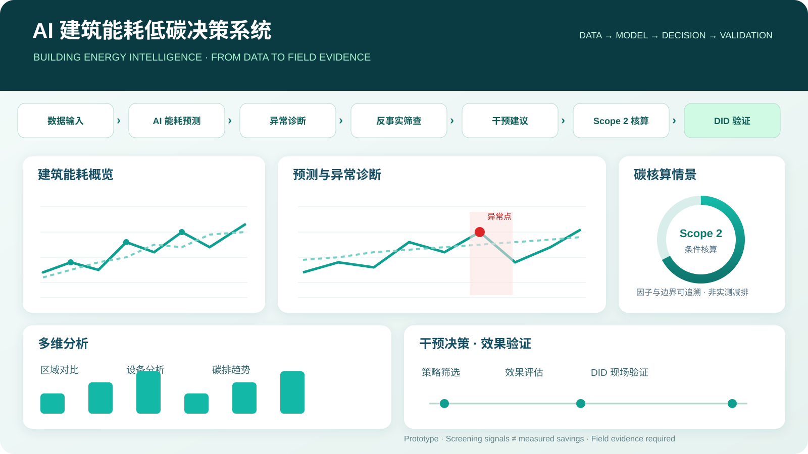
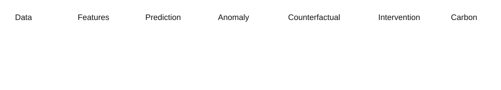

# AI-driven Building Energy Anomaly & Low-carbon Decision System

[](https://github.com/SheepYang93/ai-building-lowcarbon-/actions/workflows/ci.yml)  

> **AI for building-energy diagnosis, anomaly detection, counterfactual screening and low-carbon decision support.**

**Live demo:** https://cwtjwabswg9fdbpgvfyhul.streamlit.app/ · [Deployment guide](docs/DEPLOY_STREAMLIT_CLOUD.md) · [Run locally](#quick-start)  
**Repository:** https://github.com/SheepYang93/ai-building-lowcarbon-

## 30-second overview

**Input:** daily building-energy data.

**AI workflow:** predict expected energy use → detect anomalies → build an energy fingerprint → screen counterfactual potential → map interventions → generate conditional carbon scenarios → validate with field data.

**Output:** a building diagnosis, intervention hypothesis, potential-saving signal, report, and a treatment/control validation workflow.

The system is designed as a decision-support prototype: model evidence is kept separate from claims that require field measurement.

## Why this project

Most building-energy analytics stops at prediction. This project closes more of the decision loop:

**prediction → anomaly detection → energy fingerprint → counterfactual → intervention screening → carbon scenario → field validation**

The objective is an auditable AI workflow that turns meter data into actionable hypotheses while separating model evidence from claims that require field measurement.

## Portfolio showcase

See the [portfolio overview](docs/PORTFOLIO.md) for workflow, modules and evidence boundaries, and the [recruiter demo walkthrough](docs/RECRUITER_DEMO_WALKTHROUGH.md) for a reproducible 5–10 minute project tour.



**Data input → AI prediction → anomaly diagnosis → energy-saving decision → carbon accounting → field validation**.

## System architecture



**Live demo:** [Open Streamlit app](https://cwtjwabswg9fdbpgvfyhul.streamlit.app/) · **Code:** [GitHub repository](https://github.com/SheepYang93/ai-building-lowcarbon-)

| Layer | Method | Output |
|---|---|---|
| Data | quality checks + energy-unit/data validation | analysis-ready daily data |
| Prediction | ExtraTrees + lag/rolling features | expected energy use |
| Anomaly | rolling median + robust MAD | anomaly candidates |
| Fingerprint | persistence, recurrence, trend, morphology | building behavior type |
| Expected-use baseline | historical past-only baseline / screening | potential intervention signal |
| Intervention | fingerprint-to-action mapping | intervention family |
| Carbon | versioned electricity emission factor + accounting boundary | conditional Scope 2 CO₂ screening scenario |
| Validation | treatment/control DID, pre-trend slope diagnostic, pre-intervention placebo DID, optional clustered bootstrap interval | field evidence |

## Model design

The project uses **strict chronological validation** rather than random splitting. Historical features are shifted before rolling calculations so future observations do not enter the feature set.

Across repeated rolling-window experiments on the public dataset:

- **Example run:** R² ≈ 0.986, WAPE ≈ 5.9% on the included public-data derivative artifact
- The repository also records rolling-window robustness checks and subgroup sensitivity analysis
- Exact results vary by time window, seed, subgroup and data filtering; the included metric is an example artifact rather than a universal benchmark

See [EXPERIMENTS.md](EXPERIMENTS.md) for historical experiment records and limitations. The current reproducible evaluation protocol—including chronological holdout, common-row baseline comparison, building-group holdout, metrics and leakage tests—is documented in [MODEL_VALIDATION.md](MODEL_VALIDATION.md).

### Evidence status (current)

- **Automated regression checks:** CI covers feature leakage guards, chronological/baseline fairness, building-group separation, metric edge cases, building-level error analysis, report exports and demo/script syntax.
- **Implemented evaluation workflow:** chronological holdout, three past-only baselines, common valid-row comparison and unseen-building holdout are available in the training script.
- **Not claimed as completed:** a new full-dataset run from the current HEAD, campus deployment, verified energy savings or measured carbon reductions. Synthetic CI validates code behavior, not model performance.


**Technical review & interview notes:** [deployment checklist, evidence requirements and interview preparation](docs/TECHNICAL_REVIEW_INTERVIEW_NOTES.md)

## For a recruiter: what to look at first

If you only have one minute, run the **local demo** (or deploy it using the [Streamlit Cloud guide](docs/DEPLOY_STREAMLIT_CLOUD.md)) and then inspect these resources:

1. `app/streamlit_app.py` — the productized decision workflow and UI.
2. `src/` — feature engineering, modeling and diagnostic logic.
3. `MODEL_VALIDATION.md` — reproducible evaluation protocol, metric edge cases and evidence boundaries.
4. `EXPERIMENTS.md` — validation setup, repeated rolling-window results and limitations.
5. After running `scripts/run_v3.py` on a verified dataset, inspect `outputs/evaluation_report.docx`, `outputs/metrics.json` and `outputs/run_manifest.json` for evaluation results and dataset/runtime provenance. The manifest fingerprints the input CSV with SHA-256 and records parameters and package versions.

The project is intentionally presented as a **decision-support prototype**, not as a claim of measured energy or carbon savings. The UI separates model evidence, screening signals and field-validation evidence.

## Tech stack

| Area | Stack |
|---|---|
| Data | Python, pandas, NumPy |
| ML | scikit-learn, ExtraTrees |
| Time series | lag/rolling features, chronological validation |
| Diagnostics | robust median/MAD, anomaly screening, energy fingerprint |
| Decision support | counterfactual screening, intervention mapping, scenario analysis |
| Product | Streamlit |
| Validation | treatment/control DID, pre-trend slope diagnostic, pre-intervention placebo DID, optional clustered bootstrap interval |
| Engineering | Git, pytest, reproducible scripts |

## Demo

The Streamlit app demonstrates the full decision workflow. Open the [live demo](https://cwtjwabswg9fdbpgvfyhul.streamlit.app/) or run it locally using the [Streamlit Cloud guide](docs/DEPLOY_STREAMLIT_CLOUD.md):

1. **Overview** — system scope, polished product dashboard and evidence boundary
2. **Upload & Diagnose** — upload a single-building daily-energy CSV and run robust anomaly screening
3. **Building Diagnosis** — inspect anomaly share, temporal behavior and energy fingerprint
4. **Counterfactual** — view potential intervention signals as screening evidence
5. **Intervention** — map the fingerprint to an intervention family
6. **Carbon** — explore conditional carbon scenarios
7. **Report** — generate downloadable Markdown and Word diagnosis reports (language follows the UI setting)
8. **Field Validation** — upload treatment/control data; calculate DID, inspect pre-intervention slope diagnostics, evaluate a pre-intervention placebo date, and optionally estimate a clustered-bootstrap interval. These are preliminary diagnostics, not proof of causality.

### Demo workflow

```text
Upload CSV
   ↓
Daily aggregation
   ↓
Past-only robust anomaly detection
   ↓
Energy fingerprint
   ↓
Counterfactual screening
   ↓
Intervention recommendation
   ↓
Download report
   ↓
Treatment / Control validation
   ↓
DID
```

When generated pipeline artifacts are unavailable, the app explicitly labels the displayed evidence as **Demo mode** rather than presenting it as a live retraining result.

## Data and evidence boundary

The pipeline is designed for a BDG2-derived daily building-energy dataset. Raw data are intentionally excluded from Git. Put the dataset at:

`data/test.csv`

The derivative dataset's exact `meter_reading` unit lineage must be verified before treating readings as kWh.

> **CO₂ values are conditional Scope 2 screening scenarios until meter units, reporting boundary, factor year/geography and any green-electricity treatment are independently verified. The configured factors are electricity CO₂ factors, not full life-cycle CO₂e factors.**

## Quick start

```bash
git clone https://github.com/SheepYang93/ai-building-lowcarbon-.git
cd ai-building-lowcarbon-
pip install -r requirements.txt
python scripts/run_v3.py --input data/test.csv --output outputs
streamlit run app/streamlit_app.py
```

Windows: `run_demo.bat`  
Linux/macOS: `bash run_demo.sh`

### Synthetic demo data

A fully synthetic 4-building × 120-day dataset is included at [`examples/synthetic_building_energy.csv`](examples/synthetic_building_energy.csv). It is for checking the workflow and exploring the UI only—not real building measurements or evidence of savings. Run the pipeline without obtaining the original BDG2-derived data:

```bash
python scripts/run_v3.py --input examples/synthetic_building_energy.csv --output outputs-demo
```

For your own data, the minimum required fields are:

```text
timestamp, electricity_kwh
2026-01-01, 1234.5
2026-01-02, 1188.2
```

The uploader also accepts common aliases such as `datetime`, `date`, `energy_kwh` and `energy`.

## Engineering and reproducibility

The repository keeps the distinction between **model evidence**, **screening hypotheses** and **field evidence** explicit. This matters because a good energy-AI portfolio should show not only that a model can predict, but also where its conclusions stop being experimentally verified.

The main validation design is chronological: historical lag/rolling features are shifted so future observations do not leak into the feature set. Field-effect claims are reserved for treatment/control data and DID-style validation. The reproducible training script also runs a separate building-group holdout to measure transfer to buildings excluded from model fitting; this evaluation assumes those buildings have their own historical meter data and is not a cold-start test. Results are written to `outputs/metrics.json` and row-level held-out predictions to `outputs/unseen_building_predictions.csv`.

## Repository structure

```text
├── app/                 # Streamlit dashboard
├── data/                # Data instructions; raw data excluded
├── docs/                # Architecture diagram
├── examples/            # Small public demo artifacts
├── scripts/             # Reproducible pipeline entry points
├── src/                 # Feature engineering, modeling, anomaly logic
├── tests/               # Automated tests
├── ARCHITECTURE.md      # System design
├── EXPERIMENTS.md       # Experiment record
├── RESUME_PROJECT.md    # Resume-ready description
└── FINAL_STATUS.md      # Evidence and limitations
```

## What makes it defensible

**Leakage control:** chronological evaluation and past-only lag/rolling features.

**Building-specific diagnosis:** contextual and temporal behavior are considered instead of one global threshold.

**Robust anomaly detection:** rolling baselines and robust dispersion reduce sensitivity to isolated extremes.

**Causal humility:** prediction is not causal effect. The expected-use baseline is a screening comparison, not a proven causal counterfactual; realized savings require field validation.

**Explicit uncertainty:** unstable low-baseline cases are separated from candidates that survive robustness checks.

**Reproducibility:** the repository contains the pipeline code, tests, experiment record and small demo artifacts while excluding the large raw dataset.

## What this project does NOT claim

- No measured campus energy savings.
- No measured CO₂ reduction.
- No assumption that every meter reading is verified kWh.
- Simulated intervention percentages are scenario assumptions, not engineering measurements.
- Public-data candidates are not automatically real campus buildings.
- Counterfactual estimates are screening signals and require field validation before being interpreted as realized savings.

## Field-validation path

1. 8–12 week baseline
2. treatment/control selection
3. 4–8 week intervention
4. Difference-in-Differences (DID)
5. AI counterfactual comparison
6. placebo tests
7. measured energy and carbon accounting

## Portfolio positioning

This is an **AI + environmental engineering portfolio project** demonstrating Python/pandas/scikit-learn, time-series feature engineering, leakage-aware ML evaluation, anomaly detection, counterfactual reasoning, decision-support design, Streamlit productization and reproducibility.

See [RESUME_PROJECT.md](RESUME_PROJECT.md).

## Live demo

[Open the Streamlit demo](https://cwtjwabswg9fdbpgvfyhul.streamlit.app/). The hosted app is a portfolio prototype; availability and behavior can vary with deployment/runtime limits. For reproducible evaluation, run the pipeline locally and inspect the exported artifacts.

## License

MIT


### Evidence-strengthening features
- Simple forecasting baselines (yesterday, 7-day seasonal, 28-day median) are retained for model comparison.
- Uploaded sub-daily data preserves raw cadence and can receive same-slot anomaly screening before daily decision aggregation.
- Expected-use screening exposes a residual-based expected range rather than a point estimate alone.
- Field-validation UI includes DID, a pre-intervention slope diagnostic, a placebo DID calculated from pre-intervention observations only, and an optional building-cluster bootstrap interval. These are preliminary diagnostics, not proof of causality.
- Data quality is mapped to an evidence level; low-quality uploads are not treated as strong decision evidence.
