# Portfolio Showcase | AI Building Energy & Low-carbon Decision Support

> **Project type:** AI + building energy analytics + low-carbon decision support  
> **Role:** Independent project development · **Stack:** Python / pandas / scikit-learn / ExtraTrees / Streamlit / pytest

## One-line summary

An end-to-end prototype that turns building meter data into **energy forecasts, anomaly candidates, diagnostic fingerprints, intervention-screening suggestions, conditional Scope 2 CO₂ scenarios, and a treatment/control validation workflow**.

## Workflow at a glance

```mermaid
flowchart LR
  A[Data input<br/>meter · building · weather] --> B[Data quality<br/>cleaning & aggregation]
  B --> C[AI prediction<br/>ExtraTrees + past-only features]
  C --> D[Anomaly diagnosis<br/>robust median / MAD]
  D --> E[Energy fingerprint<br/>persistence · trend · recurrence]
  E --> F[Efficiency decision<br/>counterfactual screening & action mapping]
  F --> G[Carbon accounting<br/>factor-based Scope 2 CO₂ scenario]
  G --> H[Field validation<br/>Treatment / Control · DID]
  H --> I[Evidence report<br/>results · caveats · next actions]
```

## What the demo demonstrates

| Module | Input / method | Output |
|---|---|---|
| Data intake | Daily meter CSV; building/date fields; optional weather | Quality-checked analysis data |
| AI prediction | ExtraTrees + lag/rolling features; chronological holdout | Expected energy use and evaluation metrics |
| Anomaly diagnosis | Rolling median + robust MAD | Anomaly candidates and time patterns |
| Building fingerprint | Persistence, recurrence, trend and morphology | Behavioral profile to support diagnosis |
| Energy-saving decision | Counterfactual screening + fingerprint-to-action mapping | Intervention hypotheses—not guaranteed savings |
| Carbon accounting | Electricity emission factor + declared boundary | Conditional Scope 2 CO₂ screening scenarios |
| Field validation | Treatment/control time series; DID and diagnostics | Preliminary effect estimate and uncertainty checks |

## Evidence discipline

- **Forecast quality ≠ energy savings.** Model performance does not prove that an intervention reduced consumption.
- **Screening ≠ measured effect.** Recommendations are hypotheses that require operational review.
- **Carbon results are conditional.** Meter units, geography/year factor, reporting boundary and electricity procurement must be confirmed; configured factors are CO₂ factors, not life-cycle CO₂e.
- **DID is not automatic causal proof.** Pre-trend, placebo and clustered-bootstrap diagnostics help assess robustness but cannot replace a sound field design.
- **Building-group holdout is not cold-start.** Held-out buildings may use their own historical meter observations.

## How to explore

- **Live demo:** [Open Streamlit app](https://ai-building-lowcarbon-production-e8b1.up.railway.app)
- **Code:** [Repository](https://github.com/SheepYang93/ai-building-lowcarbon-)
- **Methods & experiments:** [EXPERIMENTS.md](../EXPERIMENTS.md)
- **Evaluation output:** run `scripts/run_v3.py`; it exports `metrics.json` and `evaluation_report.md` alongside diagnostic artifacts.

## Portfolio visual

The project overview graphic is designed around six stages: **data input → AI prediction → anomaly diagnosis → energy-saving decision → carbon accounting → field validation**. Add the generated PNG to `docs/images/` as `project-overview.png` and embed it here:

``

